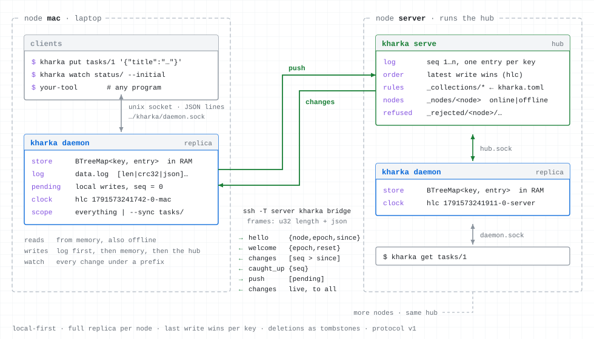

# kharka

A small local-first JSON store, written in Rust. Every machine keeps a full replica and keeps working when the network is
gone; one hub orders the changes and spreads them to every replica as a live stream.

A *kharka* (खर्क) is a high pasture in Nepal where herders bring their herds together for the summer, before every herd
goes back down to its own valley. kharka is that place for the data of your machines: each one brings its data up, and
each one takes a full copy home.

<p align="center">
  <picture>
    <source media="(prefers-color-scheme: dark)" srcset="docs/architecture-dark.svg">
    
  </picture>
</p>

- **Reads never leave the machine:** a program asks the daemon of its own machine, which answers from memory.
- **Writes land at once,** also offline; the daemon pushes them to the hub when it can reach it.
- **Watches stream every change** under a key prefix, from this machine and every other one.
- **Two kinds of data:** *state* (each machine writes only its own keys, entries go stale after a TTL), e.g. what a
  machine reports about itself; and *records* (any machine writes, the latest write wins, ordered by a hybrid logical
  clock), e.g. shared tasks or settings.
- **Collections with schemas** decide what may be written where: protected ones in a file on the hub, reloaded while
  everything runs, and any machine's own ones, defined from the command line.
- **Partial replicas:** a machine can sync only some key prefixes, to save space and traffic.
- **No database underneath:** an append-only log with checksums and snapshots, by hand. ssh is the transport and the
  authentication; the hub opens no port.

**Status:** young (0.x). Storage, daemon, hub and sync work and are tested; before 1.0 a minor release may still
change the protocol or the on-disk format, and [the changelog](CHANGELOG.md) says when it does. macOS and Linux only.
How it works: [docs/design.md](docs/design.md); how programs talk to it: [docs/protocol.md](docs/protocol.md).

## Install

A prebuilt binary (macOS and Linux, arm64 and x86_64; the Linux builds are static):

```sh
curl --proto '=https' --tlsv1.2 -LsSf https://github.com/jakobbeyer/kharka/releases/latest/download/kharka-installer.sh | sh
```

With Homebrew, or from source (Rust 1.89 or newer):

```sh
brew install jakobbeyer/tap/kharka
cargo install kharka
```

On every machine; the hub's machine needs it for `kharka serve` and for `kharka bridge`, which ssh runs there.

## Quick start

**One machine**, no hub:

```sh
kharka daemon &                                  # the replica and its socket
kharka put tasks/1 '{"title":"Price list","status":"now"}'
kharka get tasks/1
kharka watch tasks/ --initial                    # every change as a JSON line
```

**Two machines.** On the hub's machine (here `server`), the hub and a daemon of its own:

```sh
kharka serve &
kharka daemon --hub local &
```

On the other machine, a daemon that reaches the hub through ssh (`ssh server` must work without a password):

```sh
kharka daemon --hub server &
```

A write on either machine is on the other one within milliseconds; `kharka status` shows whether a daemon is synced and
how many writes still wait for the hub.

**As services:** `kharka service <daemon|serve> [args]` prints a launchd agent (macOS) or a systemd user unit (Linux)
and says where it goes:

```sh
kharka service daemon --hub server > ~/Library/LaunchAgents/dev.kharka.daemon.plist
launchctl bootstrap gui/$(id -u) ~/Library/LaunchAgents/dev.kharka.daemon.plist
```

## Commands

| command | does |
|---|---|
| `kharka daemon [--hub H] [--node N] [--sync P,…]` | runs the replica; `H` is an ssh destination, `local` or a socket path; `--sync` holds only these key prefixes |
| `kharka serve [--config F]` | runs the hub |
| `kharka bridge` | connects stdin/stdout to the hub (what ssh runs on the hub's machine) |
| `kharka get KEY [--entry]` | prints a value (or the entry with stamp and sequence number) |
| `kharka put KEY JSON\|- [--if-hlc S]` | writes a value, prints its stamp; `--if-hlc` only if the key still has that stamp |
| `kharka del KEY [--if-hlc S]` | deletes a key |
| `kharka ls [PREFIX] [--entries]` | lists keys (or entries as JSON lines) |
| `kharka watch [PREFIX] [--initial]` | prints every change as a JSON line |
| `kharka whoami`, `kharka status` | this machine's node name; the daemon's state |
| `kharka collections [NAME] [--json]` | the collections in force here; one with its schema |
| `kharka collections set NAME [--kind K] [--ttl T] [--schema F]` | defines or changes a collection of your own |
| `kharka collections rm NAME` | removes a collection of your own (its data stays) |
| `kharka collections --check FILE` | checks a kharka.toml and its schemas, without a daemon |
| `kharka service ROLE [ARGS]` | prints a service file for `daemon` or `serve` |
| `kharka completions SHELL`, `kharka man` | print a shell completion script; the man page |

Exit codes: `0` ok, `1` error, `2` usage, `3` not found (`get`, `del`, `collections rm`), `4` conflict (`--if-hlc`).

Keys are segments of `A-Z a-z 0-9 . _ -` joined by `/`; keys starting with `_` are kharka's own (`_nodes/<node>`: whether
a machine is connected to the hub). A value is any JSON document up to 1 MB.

## From a program

Shell scripts use the commands above; `kharka put KEY -` reads the value from stdin, so any program's JSON output can be
piped in. Programs that watch or write often connect to the daemon's socket (`$XDG_RUNTIME_DIR/kharka/daemon.sock`,
else `~/.local/state/kharka/daemon.sock`) and send JSON lines; every answer repeats the request's `id`:

```json
{"id":1,"op":"put","key":"status/laptop","value":{"battery":81}}
{"id":1,"ok":true,"entry":{"key":"status/laptop","value":{"battery":81},"hlc":"1791573241742-0-laptop"}}
{"id":2,"op":"watch","prefix":"status/","initial":true}
{"id":2,"ok":true,"watch":"status/"}
{"id":2,"event":"change","entry":{"key":"status/server","value":{"battery":null},"hlc":"…","seq":41}}
{"id":2,"event":"ready"}
```

The whole protocol is in [docs/protocol.md](docs/protocol.md).

## Collections

A collection gives the keys under one first segment (`tasks/…`) their rules: *state* or *record*, a TTL, a schema.

- **Protected collections** live in `~/.config/kharka/kharka.toml` on the hub, and only that file changes them. Edit it
  (or a schema file) in place: the hub notices within two seconds, or at once on `SIGHUP`, and every machine has the
  new rules immediately. A config that does not load changes nothing; `kharka collections --check FILE` tells before.
- **Own collections** are defined from any machine and travel like data, also offline:
  ```sh
  kharka collections set notes --schema note.schema.json
  kharka collections set status --kind state --ttl 30s
  kharka collections rm notes
  ```
- **Strict:** by default a key outside every collection is written unchecked; `strict = true` in the hub's file
  refuses it.
- `kharka collections` shows what is in force on a machine, and who set each collection.

A write the hub refuses (say, made offline under an older schema) is not lost: it is kept under
`_rejected/<node>/…` (`kharka ls _rejected/ --entries`), and cleared with `kharka del`. An example config is in
[contrib/](contrib/kharka.toml).

## Partial replicas

`kharka daemon --sync tasks/,status/` keeps only the keys under these prefixes on this machine; the hub sends nothing
else to it. Reading or writing other keys there is refused (`not synced`). Changing `--sync` and restarting removes what
is no longer synced and fetches what newly is.

## Shell completions and man page

Both are printed to stdout:

```sh
kharka completions zsh > ~/.zfunc/_kharka          # a folder on your $fpath
kharka completions bash > ~/.local/share/bash-completion/completions/kharka
kharka completions fish > ~/.config/fish/completions/kharka.fish
kharka man > ~/.local/share/man/man1/kharka.1
```

## When kharka fits

kharka is for a handful of machines that share small JSON documents and keep working apart: what each machine reports
about itself (a status, the agents running on it), shared tasks, settings. Every machine has everything, every change
arrives live.

It is not the tool for files or large values (at most 1 MB per key), for queries beyond key prefixes, for machines that
do not trust each other, or for many people editing the same record at once.

**Known limits:**

- Last writer wins per key: two offline edits of one record do not merge, the later one replaces the other.
- Deleted keys stay as tombstones for good, so a store with many short-lived keys grows.
- One hub: while it is away, every machine keeps working, but changes travel only when it is back.
- Every node that reaches the hub is trusted ([SECURITY.md](SECURITY.md)).
- About 100 durable writes a second per daemon on macOS (each one is synced to disk before it is answered).

## Contributing

Issues and pull requests are welcome; see [CONTRIBUTING.md](CONTRIBUTING.md). Report security problems privately, as
[SECURITY.md](SECURITY.md) describes.

## License

MIT, see [LICENSE](LICENSE).
